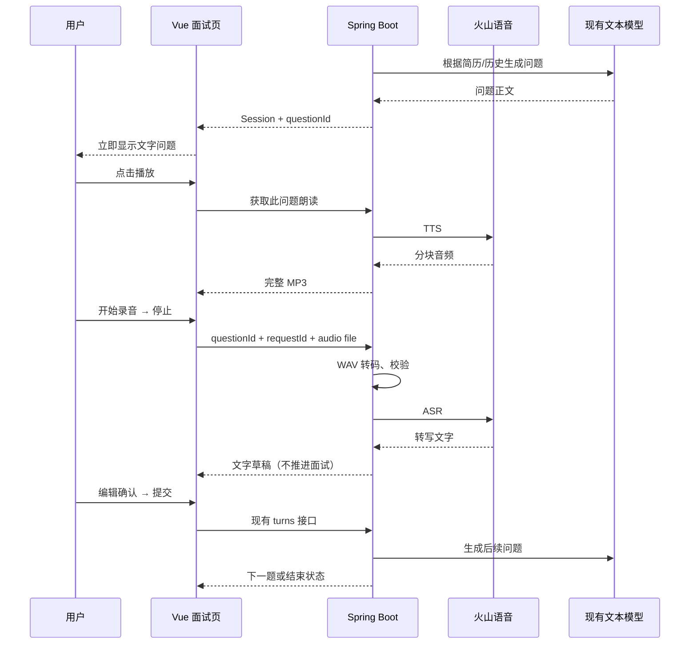

# 火山引擎语音模拟面试 Implementation Plan

> **For agentic workers:** REQUIRED SUB-SKILL: Use superpowers:subagent-driven-development (recommended) or superpowers:executing-plans to implement this plan task-by-task. Steps use checkbox (`- [ ]`) syntax for tracking.

**Goal:** 在现有简历驱动文字面试上，增加火山引擎题目朗读和“录完转写、编辑确认后提交”的语音回答。

**Architecture:** 面试状态和下一题生成继续由 `InterviewService` 管理，ASR 只返回候选回答文字，TTS 只朗读已生成的问题。Vue 通过自己的 Spring Boot 后端调用火山，后端把浏览器录音转为 WAV，把火山 TTS 分块结果拼成 MP3；前后端之间全部使用 HTTP。

**Tech Stack:** 现有 Vue 3 / Vite / Node 原生 test、Java 17 / Spring Boot 3.2.5 / JUnit 5 / JDK HttpClient；浏览器 MediaRecorder；服务端 FFmpeg + FFprobe；火山豆包语音 API。

## Global Constraints

- 用户已明确选择：火山引擎；录完转写、确认后提交。
- 本轮只产出计划和代码审查结果，不修改业务实现。
- 保留现有 `POST /api/interviews/{id}/turns` 和 `AnswerRequest(questionId, answer)`。ASR 成功不触发提交、不计入完成题数。
- 语音服务使用后端环境变量；独立于当前文本模型的 `AI_API_KEY`、`AI_BASE_URL` 和 `AI_MODEL`。不把方舟文本模型密钥默认当作语音服务密钥。
- 第一版仅一个普通话系统音色；不引入实时对话、WebSocket、流式字幕、打断、声音克隆、评分报告或数据库迁移。
- 文字问题先展示；TTS 失败可以继续回答；ASR 失败可以保留录音重试或改用文字。
- 原有会话隔离继续使用 HttpSession；后端重启记录失效、一天过期的现状维持。生产账号与持久化另立任务。
- 产品限制：每次录音最多 120 秒、上传最多 5 MiB、确认后回答最多 5000 个 UTF-16 code units（与 Java `String.length()` 和现有页面一致）。这些是本项目限制。
- 保留现有 multipart 的 `5MB / 6MB` 配置；简历仍限制 5 MiB。120 秒 16 kHz 单声道 PCM16 WAV 约 3.84 MB。
- 语音能力不能影响现有文字链路的可用性；不持有面试状态锁进行语音网络请求或转码。
- 新录音、切题、结束、重置、离开页面均要停止麦克风、播放和相关异步任务。
- 若仓库仍存在 `.codegraph/`，实施前先用 CodeGraph 定位相关符号；本轮已执行。

---

## 1. 已确认的实现与审查结果

当前调用链：

```text
Interview.vue → api/interview.js → InterviewController
  → MaterialService.upload（提取简历）
  → InterviewService.start/answer/get/finish（内存状态、浏览器归属）
  → InterviewAgent.nextQuestion（构造简历及历史提示词）
  → AiClientResolver → OpenAiCompatibleAiClient.chat
```

现有代码已经处理：逐题 `questionId`、相同回答重复提交去重、模型失败保留 `pendingAnswer`、刷新恢复服务器已保存状态、他人浏览器访问拒绝。这些机制应继续复用。

### 已复现的问题（本轮尚未修复）

| 优先级 | 位置 | 触发与结果 | 建议 |
|---|---|---|---|
| P1 | `backend/src/main/java/com/shijie/resumehelper/job/ai/OpenAiCompatibleAiClient.java:117–126`；`InterviewAgent.java:38–41` | 上游 `content` 为空、`reasoning_content` 非空时，客户端把思考文本当正式正文，Agent 接收并作为面试题返回。用本地 HTTP 服务和当前源码编译复现。 | 删除 reasoning 回退；无正式正文按模型响应无效处理。语音接入前修，否则可能直接朗读思考文本。 |
| P1（公网部署条件下） | `backend/src/main/java/com/shijie/resumehelper/job/ai/AiClientResolver.java:41–50`；`OpenAiCompatibleAiClient.java:33–35,79` | 任意非空用户 key 加自定义 Base URL，可驱动后端请求环回/内网地址。本地环回测试服务已收到请求。现有“服务端 key 不随自定义 URL 发送”的保护并未限制目的地址。 | 对浏览器提供的模型端点限制为管理员配置的 HTTPS origin 白名单，并禁止自动重定向；自建网关显式登记。语音端点固定为火山，不开放客户端传 URL。 |
| P2 | `frontend/src/views/Interview.vue:77–86` | `answer` 已成功但响应丢失，随后 `getSession` 成功恢复下一题；代码仍 `throw cause`，页面出现“响应丢失”错误，虽然提交实际成功。直接执行当前 `<script setup>`，注入 API stub 已复现。 | 恢复后检查原 `questionId` 的已保存答案；若等于本次文本，则按成功返回。 |
| P2（校验拒绝边界） | `frontend/src/views/Interview.vue:72,77,83–85,149` | 服务端返回确定的 400 校验拒绝且恢复结果 `pendingAnswer=null`，前端仍把原文本设为 `uncertainAnswer`，禁用编辑。用 5001 字回答复现。当前手工输入有 maxlength 保护，新增 ASR 程序回填会更容易触发。 | 提交前检查 strip 后长度；服务器恢复明确没有 pending 时，400 保留可编辑草稿。仅网络结果不明继续锁定原回答。 |

另有体验边界：普通未提交草稿只在 `answer` 内存里；刷新会丢失。点击“结束”目前只保存服务端已有 pending，不保存本地尚未提交的草稿。这是当前行为，不能承诺语音转写草稿刷新恢复。第一版在有草稿时明确提供“提交后结束 / 放弃草稿并结束”，不暗中提交。

### 本轮验证记录

- `cd frontend && npm test`：6 项通过。
- `cd backend && JAVA_HOME=/opt/homebrew/opt/openjdk@17 mvn -o -q -Dtest='com.shijie.resumehelper.interview.*Test' test`：14 项通过（MaterialParsing 3、InterviewFlow 5、InterviewApi 4、AiCredentialBoundary 1、InterviewModelTransport 1）。
- 后端测试需要本地端口及 Mockito attach，已在允许这些本地能力的执行环境下验证。初次受限运行的端口/缓存锁/attach 错误属于测试环境限制。
- 两个前端问题通过执行当前 Vue 脚本、注入 `ref/computed` 和 API stub 复现；没有声称完成真实浏览器验证。
- 模型思考回退和目的地址问题：仅本地环回服务、虚构密钥；没有探测任何真实内网服务。
- 火山真实账户权限、额度、音色和实际耗时尚未验证，实施 Task 1 用用户自己的语音账户完成。

## 2. 火山接口选择和格式决策

截至 2026-10-13 核查的官方接口：

| 能力 | 第一版选择 | 应用内行为 |
|---|---|---|
| ASR | `POST https://openspeech.bytedance.com/api/v3/auc/bigmodel/recognize/flash`，资源 `volc.bigasr.auc_turbo` | WAV bytes 经 Base64 放进 `audio.data`，同步取转写文字；无需公网录音 URL 或对象存储。 |
| TTS | `POST https://openspeech.bytedance.com/api/v3/tts/unidirectional`，资源 `seed-tts-2.0` | 输入问题文字；后端消费分块数据，拼出完整 MP3，再返回浏览器。 |

ASR 的 WAV/MP3/OGG OPUS 支持范围、新旧控制台鉴权和 `audio.data` 见[录音文件极速版识别 HTTP](https://docs.volcengine.com/docs/DoubaoVoice/LargemodelrecordingfileLiterecognitionAPI?lang=zh)。TTS 的分块数据、结束事件和 resource/音色匹配见[HTTP Chunked/SSE 单向流式 V3](https://docs.volcengine.com/docs/DoubaoVoice/HTTPChunkedSSEUnidirectionalStreaming-V3?lang=zh)；新版请求字段见[单向流式语音合成 HTTP](https://docs.volcengine.com/docs/DoubaoVoice/unidirectional-streaming-text-to-speech-http?lang=zh)。

实施时必须留意三个协议细节：

1. 浏览器录音用能力探测选 MIME，通常会得到 WebM/Opus 或 MP4/AAC；不能把扩展名改成 `.wav` 就上传火山。服务端真实转码为 WAV。
2. ASR 不仅检查 HTTP 状态，还检查 `X-Api-Status-Code`；静音、空音频、格式错误均给可读提示。
3. TTS 不是一个完整 JSON 或可直接播放的原始 MP3 响应；逐个解码音频片段，确认成功结束。不能把非零成功结束码当作失败，也不能在连接提前断开时播放半成品。实现以详细 V3 文档和真实 smoke test 为准。

选 FFmpeg 的原因：让 Chrome/Edge 与 Safari 的录音封装在后端统一，避免在前端维护编码器和重采样器。代价是后端运行机器需要两个可执行文件；纳入运行文档和部署检查。仅前端 `MediaRecorder` 的 `sampleRate` 约束不能证明最终音频就是 16 kHz。

## 3. 用户流程与状态



页面语音状态独立于现有 `busy`：

```text
idle → requesting-mic → recording → recorded → transcribing → transcript-ready
                                                ↘ error（保留录音，可重试）
```

- 首期手动“播放题目 / 重播 / 停止”；默认不自动播放，避免恢复页面时浏览器自动播放拦截。
- 点击录音先停止 TTS，避免把题目播报录进回答。录音和 ASR 中禁用提交、切换文字输入和正常结束；“取消录音/识别”始终可用。
- 转写先显示独立预览。已有文字草稿时提供“替换草稿 / 追加到草稿 / 保留原草稿”，用户选择后才写入 `answer`。
- pending 状态不允许重新录音或覆盖原回答；沿用原回答重试。
- ASR 响应带回同一 `sessionId/questionId/requestId`；前端检查这三项和本地操作序号后才接受。
- 取消请求只代表页面不再接收结果，不能承诺已取消的第三方调用不计费。第一版不自动重试付费调用；由用户主动重试。
- 麦克风拒绝、没有设备、不支持 MediaRecorder、HTTPS 条件不满足均显示原因并保持文字输入可用。

## 4. API 与后端边界

新增接口，不改 Session / Turn JSON：

| 方法与路径 | 输入 | 返回 | 约束 |
|---|---|---|---|
| `GET /api/interview-speech/capabilities` | 无 | `{success:true,data:{asrEnabled,ttsEnabled,maxRecordingSeconds:120,maxAudioBytes:5242880}}` | 仅表明本机配置完整/转码工具可执行，不宣称已验证账户额度。 |
| `POST /api/interviews/{id}/questions/{questionId}/speech` | 无文本请求体 | `audio/mpeg` bytes；失败为现有 JSON envelope | 从本人 Session 的 Turn 取文字；禁止传任意朗读文字；允许本人历史题重播。 |
| `POST /api/interviews/{id}/transcriptions` | multipart `file`、`questionId`、UUID `requestId` | `{success:true,data:{sessionId,questionId,requestId,text,durationMs}}` | 开始与结束均确认本人、ACTIVE、当前题、无 pending；不保存 answer、不调用 LLM。 |

前端调用语音接口仍 `credentials: 'include'`，不携带 `X-AI-*` 或火山凭据。二进制成功响应与 JSON 错误分开解析。

语音错误统一：400（缺参数/空录音）、404（会话归属/不存在）、409（切题/结束/pending）、413（上传过大）、415（封装/解码不支持）、422（静音/超时长/无识别文字）、429（本应用并发限制）、502（厂商响应或权限异常）、503（未配置/缺工具）、504（厂商调用或转码超时）。上游具体错误码、阶段、requestId、logid 写日志；不记录密钥、原始录音、全文回答或上游完整 body。

音频生命周期：ASR 文件只留独立临时目录，成功、失败、超时均 finally 删除。TTS 第一版只在当前页面保存 Blob，重复播放复用，不建立公共音频目录或永久音频链接；切题撤销旧 Object URL。刷新后重播会再次合成，这一成本由验收记录决定是否再增加有界服务器缓存。

配置建议（加入 `backend/src/main/resources/application.yml`）：

```yaml
app:
  interview:
    speech:
      api-key: ${VOLC_SPEECH_API_KEY:}
      asr-resource-id: volc.bigasr.auc_turbo
      tts-resource-id: seed-tts-2.0
      tts-speaker: ${VOLC_TTS_SPEAKER:zh_female_vv_uranus_bigtts}
      ffmpeg-path: ${FFMPEG_PATH:ffmpeg}
      ffprobe-path: ${FFPROBE_PATH:ffprobe}
      max-audio-bytes: 5242880
      max-duration-seconds: 120
      asr-timeout-seconds: 60
      tts-timeout-seconds: 30
      conversion-timeout-seconds: 10
      max-concurrent-requests: 2
```

以上音色是官方请求示例中的 2.0 音色，最终以控制台权限和 smoke test 成功为准。应用启动时检查工具可执行性；语音能力关闭不阻止文字面试启动。测试可注入本地 transport URI，生产 URI 为代码固定常量，不绑定浏览器或环境提供的任意 URL。

## 5. 文件职责

以下相对路径均从仓库根目录开始；新增文件先按现有包的平铺结构组织。

| 文件 | 职责 |
|---|---|
| `backend/src/main/java/com/shijie/resumehelper/interview/SpeechProperties.java` | 独立配置绑定；不复用岗位 Ai 配置。 |
| `backend/src/main/java/com/shijie/resumehelper/interview/SpeechClient.java` | ASR/TTS 抽象、结果记录；不处理面试状态。 |
| `backend/src/main/java/com/shijie/resumehelper/interview/VolcengineSpeechClient.java` | 固定 endpoint、鉴权、超时、ASR 响应/TTS JSON 流解析。 |
| `backend/src/main/java/com/shijie/resumehelper/interview/AudioNormalizer.java` | 有界读入、FFprobe 验证、FFmpeg 转码、临时文件清理。 |
| `backend/src/main/java/com/shijie/resumehelper/interview/InterviewSpeechService.java` | 会话授权/题目检查、进程内并发上限、调用语音客户端、调用后重校验。 |
| `backend/src/main/java/com/shijie/resumehelper/interview/InterviewSpeechController.java` | 三个语音 REST 接口，保持 JSON 错误格式和二进制成功响应。 |
| `backend/src/main/java/com/shijie/resumehelper/interview/InterviewErrorHandler.java` | 将 advice 作用范围扩展到语音 controller，否则 InterviewException 可能被全局兜底变成 500。 |
| `backend/src/main/java/com/shijie/resumehelper/job/ai/OpenAiCompatibleAiClient.java` | 修复 reasoning 回退和浏览器自定义 endpoint 安全边界。 |
| `backend/src/main/java/com/shijie/resumehelper/job/ai/AiClientResolver.java` | 校验用户传入的模型端点 origin。 |
| `backend/src/main/java/com/shijie/resumehelper/job/config/JobModuleProperties.java` | 增加允许浏览器使用的自定义模型 HTTPS origin 列表。 |
| `frontend/src/api/interview.js` | capabilities、转写、二进制朗读、AbortSignal。 |
| `frontend/src/interview/useVoiceRecorder.js` | 录音状态、MIME 能力探测、大小/时长限制、麦克风清理。 |
| `frontend/src/interview/useQuestionSpeech.js` | 当前题 Blob 缓存、播放/暂停/停止、异步结果保护、Object URL 清理。 |
| `frontend/src/views/Interview.vue` | 文字状态修复、语音控制、转写预览和确认流程。 |
| `frontend/src/api/interview-flow.test.js` | 当前 Vue 脚本的提交恢复边界测试。 |
| `frontend/src/api/interview-speech.test.js` | 语音 HTTP 客户端测试（现有 npm test glob 会执行）。 |
| `frontend/src/interview/*.test.js` | 录音/播放生命周期与迟到结果测试；修改 npm test 同时纳入。 |
| `backend/src/test/java/com/shijie/resumehelper/interview/SpeechClientTest.java` | 本地 HTTP 模拟火山，真实传输及协议边界。 |
| `backend/src/test/java/com/shijie/resumehelper/interview/AudioNormalizerTest.java` | 真工具测试：小音频、不可解码、超长、超时、清理。 |
| `backend/src/test/java/com/shijie/resumehelper/interview/InterviewSpeechApiTest.java` | 归属、状态、不推进轮次、JSON 错误与二进制响应。 |
| `backend/docs/语音面试接口与接入.md` | 控制台开通、配置、FFmpeg 安装、接口和故障排查。 |
| `README.md`；`backend/docs/文字面试接口与接入.md`；`AI求职与面试平台_20天课程项目方案.md` | 更新功能范围和入口；本次 ASR 作为已批准的 MVP 扩展，修正原文“暂缓 ASR”。 |

## 6. 实施任务

任务结束均先运行对应验证，再提交独立 commit。以下是实施步骤，当前未执行。

### Task 1：先完成火山账户与音频兼容性验证（约半天）

**Files:**
- Create: `backend/docs/语音面试接口与接入.md`
- Create: `backend/tools/speech-smoke.py`

**Interfaces:**
- Consumes: `VOLC_SPEECH_API_KEY`、`VOLC_TTS_SPEAKER`；本机 FFmpeg/FFprobe。
- Produces: 可重复的真实 ASR/TTS 调用证据、实际音色、短中文与技术名词样本表现。

- [ ] **Step 1：验证缺配置失败。** smoke 脚本启动先读取环境，缺 key 立即退出并打印“请配置 VOLC_SPEECH_API_KEY”，不打印 key；正常 CI 不执行付费 smoke。
- [ ] **Step 2：用下面的核心请求验证 TTS→文件→ASR。** `speech-smoke.py` 使用 Python 标准库 `urllib.request`、`json`、`base64`、`uuid`；密钥只从环境取。

```python
import base64, json, os, pathlib, tempfile, urllib.request, uuid

key = os.environ.get('VOLC_SPEECH_API_KEY', '').strip()
if not key:
    raise SystemExit('请配置 VOLC_SPEECH_API_KEY')
speaker = os.environ.get('VOLC_TTS_SPEAKER', 'zh_female_vv_uranus_bigtts')
headers = {'Content-Type': 'application/json', 'X-Api-Key': key,
           'X-Api-Resource-Id': 'seed-tts-2.0', 'X-Api-Request-Id': str(uuid.uuid4())}
body = {'req_params': {'text': '请介绍你如何用 Redis 优化 Spring Boot 项目的缓存。',
        'speaker': speaker, 'audio_params': {'format': 'mp3', 'sample_rate': 24000}}}
request = urllib.request.Request(
    'https://openspeech.bytedance.com/api/v3/tts/unidirectional',
    data=json.dumps(body).encode(), headers=headers, method='POST')
audio = bytearray()
complete = False
with urllib.request.urlopen(request, timeout=30) as response:
    for line in response:
        if not line.strip():
            continue
        part = json.loads(line)
        if part['code'] == 20000000:
            complete = True
            break
        if part['code'] != 0:
            raise RuntimeError(f"TTS 业务失败，code={part['code']}")
        if part.get('data'):
            audio.extend(base64.b64decode(part['data'], validate=True))
if not complete or not audio:
    raise RuntimeError('TTS 缺少完整结束事件或音频数据')
output = pathlib.Path(tempfile.gettempdir()) / 'interview-speech-smoke.mp3'
output.write_bytes(audio)
headers.update({'X-Api-Resource-Id': 'volc.bigasr.auc_turbo',
                'X-Api-Request-Id': str(uuid.uuid4()), 'X-Api-Sequence': '-1'})
body = {'user': {'uid': 'interview-smoke'},
        'audio': {'data': base64.b64encode(audio).decode()},
        'request': {'model_name': 'bigmodel'}}
request = urllib.request.Request(
    'https://openspeech.bytedance.com/api/v3/auc/bigmodel/recognize/flash',
    data=json.dumps(body).encode(), headers=headers, method='POST')
with urllib.request.urlopen(request, timeout=60) as response:
    if response.headers.get('X-Api-Status-Code') != '20000000':
        raise RuntimeError('ASR 业务失败，code=' + response.headers.get('X-Api-Status-Code', 'missing'))
    result = json.load(response)
print('音频输出：', output)
print(result['result']['text'])
```

运行：`python3 backend/tools/speech-smoke.py`。期望生成可播放 MP3，并返回含 Redis/Spring Boot 项目含义的中文文本。该固定样例不是准确率基准。

- [ ] **Step 3：验证浏览器真实录音。** Chrome/Edge 与 Safari 分别录制 10 秒和 120 秒中文回答，记录实际 MIME；使用以下参数转换，确认识别原音频对应的回答。选择取消后不用计入样本。

```text
ffprobe -v error -show_entries format=duration -of json input.webm
ffmpeg -nostdin -hide_banner -loglevel error -y -i input.webm -map 0:a:0 -vn -ac 1 -ar 16000 -c:a pcm_s16le output.wav
```

- [ ] **Step 4：记录资源权限、音色、3 组 10/60/120 秒回答的耗时、专有名词错误和实际请求用量。** 不把 key 写进文档；如果接口 framing 与详细 V3 文档不一致，先调整 protocol fixture，再开始 Task 3。
- [ ] **Step 5：提交文档与 smoke 工具。** `git add backend/docs/语音面试接口与接入.md backend/tools/speech-smoke.py && git commit -m "docs: verify Volcengine interview speech integration"`。

### Task 2：修复文字链路边界（约半天，可独立验收）

**Files:**
- Modify: `backend/src/main/java/com/shijie/resumehelper/job/ai/OpenAiCompatibleAiClient.java`
- Modify: `backend/src/main/java/com/shijie/resumehelper/job/ai/AiClientResolver.java`
- Modify: `backend/src/main/java/com/shijie/resumehelper/job/config/JobModuleProperties.java`
- Modify: `backend/src/test/java/com/shijie/resumehelper/interview/InterviewModelTransportTest.java`
- Modify: `backend/src/test/java/com/shijie/resumehelper/interview/AiCredentialBoundaryTest.java`
- Modify: `frontend/src/views/Interview.vue`
- Create: `frontend/src/api/interview-flow.test.js`

**Interfaces:**
- Consumes: 现有 `api.answer/getSession`、`Session.turns/pendingAnswer`。
- Produces: 无 reasoning 泄出、可判断提交恢复成功、确定校验拒绝保留可编辑草稿；浏览器只能使用配置准许的模型 origin。

- [ ] **Step 1：先写失败测试。** 对本地模型 HTTP stub 返回 `{"choices":[{"message":{"content":"","reasoning_content":"思考过程"}}]}`，断言 `AiClient.AiException`，并断言 `InterviewService` 不创建新问题。前端注入 `answer` 抛网络错误、`getSession` 返回已保存该回答的下一题，期望 `error==''`；注入 400 校验错误、恢复原题且无 pending，期望草稿可编辑。
- [ ] **Step 2：运行，确认新增断言在当前实现失败。** `cd frontend && npm test`；`cd backend && JAVA_HOME=/opt/homebrew/opt/openjdk@17 mvn -Dtest=InterviewModelTransportTest,AiCredentialBoundaryTest test`。
- [ ] **Step 3：正文解析只接受 content，删除 reasoning 回退。**

```java
String content = message.path("content").asText("");
if (content.isBlank()) throw new AiException("大模型没有返回可用文本", true);
return content;
```

- [ ] **Step 4：提交前检查长度，并替换 submitAnswer 的 catch 分支。** 参数校验使用现有提示；恢复失败时原题的 uncertain 文本继续保留。

```javascript
const text = pending.value ?? answer.value.trim()
if (!text || !current.value) return
if (text.length > 5000) {
  error.value = '回答不能超过 5000 字，请精简后提交。'
  return
}
```

```javascript
} catch (cause) {
  let recovered = false
  try {
    applySession(await api.getSession(session.value.sessionId))
    recovered = true
  } catch { /* 原提交结果未知，保留同一回答供重试。 */ }
  if (recovered) {
    const saved = session.value.turns.find(t => t.questionId === questionId)
    if (saved?.answer === text) return
  }
  if (session.value?.currentQuestion?.questionId === questionId &&
      session.value.pendingAnswer == null) {
    answer.value = text
    uncertainAnswer.value = recovered && cause.status === 400 ? null : text
  }
  throw cause
}
```

- [ ] **Step 5：对浏览器自定义模型目的地址做 origin 白名单，禁止重定向。** 新增 `JobModuleProperties.Ai.allowedBrowserOrigins`，默认 `https://api.deepseek.com`、`https://dashscope.aliyuncs.com`、`https://ark.cn-beijing.volces.com`，部署者可登记自己的可信 HTTPS 网关。`AiClientResolver.fromRequest` 只在 headerKey 非空且请求提供 Base URL 时调用下面的校验；调用后才构造 credentials。`HttpClient.followRedirects` 改为 `NEVER`。管理员服务端配置不经用户白名单校验，允许本地测试服务器。

```java
private static void validateBrowserEndpoint(String url, java.util.List<String> allowedOrigins) {
    java.net.URI uri;
    try { uri = java.net.URI.create(url); }
    catch (IllegalArgumentException e) { throw new IllegalArgumentException("模型地址格式不正确"); }
    if (!"https".equalsIgnoreCase(uri.getScheme()) || uri.getHost() == null ||
        uri.getRawUserInfo() != null || uri.getRawFragment() != null || uri.getRawQuery() != null)
        throw new IllegalArgumentException("模型地址须为已登记的 HTTPS 地址");
    int port = uri.getPort() < 0 ? 443 : uri.getPort();
    boolean allowed = allowedOrigins.stream().map(java.net.URI::create).anyMatch(origin ->
        "https".equalsIgnoreCase(origin.getScheme()) && origin.getHost() != null &&
        origin.getHost().equalsIgnoreCase(uri.getHost()) &&
        (origin.getPort() < 0 ? 443 : origin.getPort()) == port);
    if (!allowed) throw new IllegalArgumentException("模型服务地址未登记，请联系部署者配置可信网关");
}
```

白名单由部署者维护且只列可信 origin；不接受浏览器临时登记。已有测试中 arbitrary user URL 被允许的断言需改为“登记后允许、未登记拒绝”，增加环回 IP、userinfo、非 HTTPS、非登记端口和重定向不跟随测试。

- [ ] **Step 6：通过上述测试和原有 14 个后端/6 个前端测试，提交。** `git commit -m "fix: preserve interview submission boundaries and model response safety"`（提交前 git add 本任务明确列出的文件）。

### Task 3：实现音频处理与火山适配（约 1 天）

**Files:**
- Create: 本文第 5 节的 `SpeechProperties.java`、`SpeechClient.java`、`VolcengineSpeechClient.java`、`AudioNormalizer.java`
- Modify: `backend/src/main/resources/application.yml`
- Create: `SpeechClientTest.java`、`AudioNormalizerTest.java`（第 5 节完整路径）

**Interfaces:**
- Consumes: 第 4 节的独立语音配置和固定火山 endpoints。
- Produces: `SpeechClient.transcribe(byte[] wav, String requestId)`、`SpeechClient.synthesize(String text, String requestId)`；`AudioNormalizer.normalize(MultipartFile file)`。

接口定义：

```java
package com.shijie.resumehelper.interview;

public interface SpeechClient {
    record Transcript(String text, long durationMs) {}
    record SpeechAudio(byte[] bytes, String contentType) {}
    Transcript transcribe(byte[] wav, String requestId);
    SpeechAudio synthesize(String text, String requestId);
}
```

```java
// AudioNormalizer 的输出；不把临时 Path 泄露给上层。
public record NormalizedAudio(byte[] wav, long durationMs) {}
```

- [ ] **Step 1：本地 stub 写协议失败测试。** ASR HTTP 200 + 静音状态不当成功；缺状态头拒绝；空文字拒绝；TTS 多个 JSON 音频片段合并，结束成功；缺结束事件、错误片段、无音频、错误 Base64 均拒绝。不要让 TCP chunk 边界决定 JSON 解码边界。

```java
// 放入 SpeechClientTest，提供给本地 HTTP handler 的 fixture。
String okStream = "{\"code\":0,\"data\":\"AQI=\"}\n"
        + "{\"code\":0,\"data\":\"AwQ=\"}\n"
        + "{\"code\":20000000,\"data\":null}\n";
byte[] expected = new byte[]{1, 2, 3, 4};
// 本地 stub 分拆网络写入，客户端结果应 assertArrayEquals(expected, audio.bytes())。
String partialStream = "{\"code\":0,\"data\":\"AQI=\"}\n";
// partialStream 必须抛 InterviewException，不能返回 {1,2}。
```

- [ ] **Step 2：运行失败测试。** `cd backend && JAVA_HOME=/opt/homebrew/opt/openjdk@17 mvn -Dtest=SpeechClientTest,AudioNormalizerTest test`，新增类/方法未实现阶段应失败。
- [ ] **Step 3：实现请求构造，使用 JDK HttpClient、禁用重定向，连接超时 5 秒。** 密钥读取 `SpeechProperties`，每次请求带新的 request ID。厂商格式限于适配器内部。

```java
// ASR JSON，mapper 为注入的 ObjectMapper。
var body = mapper.createObjectNode();
body.putObject("user").put("uid", "resume-helper");
body.putObject("audio").put("data", java.util.Base64.getEncoder().encodeToString(wav));
body.putObject("request").put("model_name", "bigmodel");
// Header: X-Api-Key、X-Api-Resource-Id=volc.bigasr.auc_turbo、
// X-Api-Request-Id=requestId、X-Api-Sequence=-1、Content-Type=application/json。

// TTS JSON。
var tts = mapper.createObjectNode();
var params = tts.putObject("req_params");
params.put("text", text);
params.put("speaker", properties.getTtsSpeaker());
params.putObject("audio_params").put("format", "mp3").put("sample_rate", 24000);
// Header: X-Api-Key、X-Api-Resource-Id=seed-tts-2.0、X-Api-Request-Id=requestId。
```

ASR 响应最多读取 1 MiB；先验 HTTP 2xx，再验业务状态。静音/空识别返回 422；权限和配置异常 502；连接/总调用超时 504。不要回传原始上游错误全文。

- [ ] **Step 4：实现 TTS 完整音频解析。** 使用 Jackson `readValues` 解析连续根 JSON，屏蔽网络 chunk 边界；限总音频 5 MiB。给整个消费阶段设置 30 秒 deadline，超时关闭 InputStream 并取消 reader 任务：`HttpRequest.timeout` 加 `BodyHandlers.ofInputStream` 不能单独证明已限制全部流读取时间。

```java
private SpeechClient.SpeechAudio readTts(java.io.InputStream input) throws java.io.IOException {
    var out = new java.io.ByteArrayOutputStream();
    boolean complete = false;
    try (com.fasterxml.jackson.databind.MappingIterator<com.fasterxml.jackson.databind.JsonNode> parts =
            mapper.readerFor(com.fasterxml.jackson.databind.JsonNode.class).readValues(input)) {
        while (parts.hasNextValue()) {
            com.fasterxml.jackson.databind.JsonNode part = parts.nextValue();
            int code = part.path("code").asInt(-1);
            if (code == 20000000) { complete = true; break; }
            if (code != 0) throw new InterviewException(502, "题目语音生成失败，请稍后重试");
            String data = part.path("data").asText("");
            if (!data.isEmpty()) {
                byte[] bytes;
                try { bytes = java.util.Base64.getDecoder().decode(data); }
                catch (IllegalArgumentException e) { throw new InterviewException(502, "语音服务返回无效音频"); }
                if ((long) out.size() + bytes.length > 5L * 1024 * 1024)
                    throw new InterviewException(502, "题目音频超过大小限制");
                out.writeBytes(bytes);
            }
        }
    }
    if (!complete || out.size() == 0) throw new InterviewException(502, "题目语音未完整生成，请重试");
    return new SpeechClient.SpeechAudio(out.toByteArray(), "audio/mpeg");
}
```

- [ ] **Step 5：实现规范化。** `normalize` 创建独立临时目录；有界读取 `MAX_BYTES+1`；使用真实封装探测，不信任文件名/MIME；FFprobe 拒绝非有限时长、无音轨和大于 120 秒的录音，再转码，不用 `-t 120` 默默截断。FFmpeg 命令如下，10 秒超时强制结束并等待进程退出；stderr 重定向到该临时目录中的文件避免 pipe 填满。关闭网络输入，只使用本地路径。

```java
var args = java.util.List.of(properties.getFfmpegPath(),
    "-nostdin", "-hide_banner", "-loglevel", "error", "-y",
    "-protocol_whitelist", "file,pipe", "-i", inputPath.toString(),
    "-map", "0:a:0", "-vn", "-ac", "1", "-ar", "16000",
    "-c:a", "pcm_s16le", outputPath.toString());
Process process = new ProcessBuilder(args)
    .redirectError(errorPath.toFile()).redirectOutput(ProcessBuilder.Redirect.DISCARD).start();
if (!process.waitFor(10, java.util.concurrent.TimeUnit.SECONDS)) {
    process.destroyForcibly();
    process.waitFor();
    throw new InterviewException(504, "录音转换超时，请缩短录音后重试");
}
if (process.exitValue() != 0) throw new InterviewException(415, "无法读取录音格式，请重新录音");
```

FFprobe 同样以 `ProcessBuilder` 参数数组执行，设置相同协议白名单和超时；允许实际 wav、mp3、ogg、webm/matroska、mp4/mov 音频封装，拒绝播放列表。转码结果有界读入，并验证 WAV RIFF/WAVE 头。InterruptedException 路径强制结束子进程、恢复 interrupt；finally 从子文件到目录逐层删除。

- [ ] **Step 6：用实际 Chrome/Safari 录音小 fixture 做真转码测试。** 超长样本用 lavfi 生成；不让真实工具测试悄悄跳过，测试前 `ffmpeg -version`、`ffprobe -version`。分别验证无效 bytes、121 秒样本、子进程超时、输入与输出均清理。
- [ ] **Step 7：测试通过后提交。** `git commit -m "feat: add bounded Volcengine speech adapters and audio conversion"`，先 git add 本任务文件。

### Task 4：实现带会话归属的语音接口（约半天）

**Files:**
- Create: `InterviewSpeechService.java`、`InterviewSpeechController.java`、`InterviewSpeechApiTest.java`（第 5 节完整路径）
- Modify: `InterviewErrorHandler.java`（第 5 节完整路径）

**Interfaces:**
- Consumes: `InterviewService.get(owner, id)`、Task 3 的 SpeechClient/AudioNormalizer。
- Produces: 第 4 节三个接口；转写记录 `Transcription(sessionId, questionId, requestId, text, durationMs)`。

- [ ] **Step 1：用 MockMvc + mock SpeechClient 写失败测试。** 他人会话 404、FINISHED/非当前题/pending 409、缺 file 400、超限上传 413、成功 ASR 后 `turns/status/pendingAnswer` 与调用前完全一致；TTS 取服务端问题，不接受用户自定义文字。增加语音 advice 对 409 的状态验证。
- [ ] **Step 2：运行失败测试。** `cd backend && JAVA_HOME=/opt/homebrew/opt/openjdk@17 mvn -Dtest=InterviewSpeechApiTest test`。
- [ ] **Step 3：实现输入与结果记录。**

```java
// 定义在 InterviewSpeechService 内。
public record Transcription(String sessionId, String questionId, String requestId,
                            String text, long durationMs) {}

private InterviewService.Turn requireAnswerable(String owner, String id, String questionId) {
    var session = interviews.get(owner, id);
    if (!"ACTIVE".equals(session.status()) || session.pendingAnswer() != null ||
        session.currentQuestion() == null ||
        !session.currentQuestion().questionId().equals(questionId))
        throw new InterviewException(409, "面试状态已变化，请同步当前题目后继续");
    return session.currentQuestion();
}
```

- [ ] **Step 4：实现服务编排。** 先验证 UUID requestId 和参数，再调用 `requireAnswerable`，获取进程内 Semaphore permit（全局 2、同一 owner 最多 1；无法获取立即 429），规范化音频→转写→再次 `requireAnswerable`。finally 释放 permit。返回规范化音频的时长和原始转写文字；超过 5000 字不截断，在前端提示精简，提交接口仍做最终校验。TTS 先通过 `interviews.get` 查所属 Turn，再取得 permit 合成；不调用 nextQuestion，不持状态锁等待。
- [ ] **Step 5：定义路由，返回实际音频 Content-Type。**

```java
@PostMapping("/interviews/{id}/questions/{questionId}/speech")
public org.springframework.http.ResponseEntity<byte[]> speech(
        @PathVariable String id, @PathVariable String questionId,
        jakarta.servlet.http.HttpServletRequest request) {
    var audio = speechService.synthesize(request.getSession(true).getId(), id, questionId);
    return org.springframework.http.ResponseEntity.ok()
        .header("Cache-Control", "no-store")
        .contentType(org.springframework.http.MediaType.parseMediaType(audio.contentType()))
        .body(audio.bytes());
}

@PostMapping(value = "/interviews/{id}/transcriptions", consumes = "multipart/form-data")
public com.shijie.resumehelper.common.ApiResponse<InterviewSpeechService.Transcription> transcribe(
        @PathVariable String id, @RequestParam String questionId,
        @RequestParam String requestId,
        @RequestParam("file") org.springframework.web.multipart.MultipartFile file,
        jakarta.servlet.http.HttpServletRequest request) {
    return com.shijie.resumehelper.common.ApiResponse.ok(speechService.transcribe(
        request.getSession(true).getId(), id, questionId, requestId, file));
}
```

`Transcription` 固定定义在 `InterviewSpeechService` 内。capabilities 为服务端可用开关和本文配置限制，接口不调用厂商。

- [ ] **Step 6：扩展 advice scope。**

```java
@RestControllerAdvice(assignableTypes = {InterviewController.class, InterviewSpeechController.class})
@Order(-1)
```

- [ ] **Step 7：并发测试。** stub ASR 用 latch 阻塞；其他请求提交或结束面试，再释放 ASR，结果 409；未调用 answer/nextQuestion。另测同 owner 第二个请求 429、异常后 permit 可再次取得。
- [ ] **Step 8：接口和原测试通过后提交。** `git commit -m "feat: add session-scoped interview speech endpoints"`，先 git add 本任务文件。

### Task 5：前端 API、录音与朗读生命周期（约 1 天）

**Files:**
- Modify: `frontend/src/api/interview.js`、`frontend/package.json`
- Create: `frontend/src/api/interview-speech.test.js`、`frontend/src/interview/useVoiceRecorder.js`、`frontend/src/interview/useQuestionSpeech.js`、`frontend/src/interview/useVoiceRecorder.test.js`、`frontend/src/interview/useQuestionSpeech.test.js`

**Interfaces:**
- Consumes: Task 4 接口。
- Produces: `api.getSpeechCapabilities()`、`api.transcribe(id,{questionId,requestId,file},signal)`、`api.questionSpeech(id,questionId,signal): Promise<Blob>`；`useVoiceRecorder({maxSeconds,maxBytes,mediaDevices,Recorder})` 返回 `state,blob,durationSeconds,error,start,stop,cancel,dispose`；`useQuestionSpeech({api,createAudio,createUrl,revokeUrl})` 返回 `state,error,play,stop,dispose`。

- [ ] **Step 1：写失败测试。** multipart boundary 由浏览器管理；携带 cookies 和 AbortSignal；不发送 LLM headers；TTS JSON 错误不会当 Blob 播放；麦克风许可迟到后 cancel 不启动录音；切题后旧音频响应不播放。
- [ ] **Step 2：npm test 加入新目录后运行，确认失败。**

```json
"test": "node --test src/api/*.test.js src/interview/*.test.js"
```

- [ ] **Step 3：request 增加 signal 并新增 API 方法。** 在现有 `request` 的 options destructuring 中加入 `signal`，fetch options 加 `signal`，其余鉴权行为保持。新增方法代码：

```javascript
getSpeechCapabilities: () => request('/interview-speech/capabilities'),
transcribe(id, { questionId, requestId, file }, signal) {
  const body = new FormData()
  body.append('questionId', questionId)
  body.append('requestId', requestId)
  body.append('file', file, file.name || 'answer-audio')
  return request(`${sessionPath(id)}/transcriptions`, { method: 'POST', body, signal })
},
async questionSpeech(id, questionId, signal) {
  const reply = await fetchImpl(`${root}${sessionPath(id)}/questions/${encodeURIComponent(questionId)}/speech`, {
    method: 'POST', credentials: 'include', signal
  })
  if (!reply.ok) {
    const envelope = await reply.json().catch(() => null)
    throw Object.assign(new Error(envelope?.message || `语音请求失败（HTTP ${reply.status}）`), { status: reply.status })
  }
  if (!(reply.headers.get('Content-Type') || '').toLowerCase().startsWith('audio/mpeg'))
    throw new Error('题目语音响应格式异常，请重试。')
  const blob = await reply.blob()
  if (!blob.size || blob.size > 5 * 1024 * 1024) throw new Error('题目音频为空或超过大小限制。')
  return blob
},
```

- [ ] **Step 4：录音 MIME 能力探测，不手工伪装封装。**

```javascript
const mimeType = ['audio/webm;codecs=opus', 'audio/mp4', 'audio/ogg;codecs=opus']
  .find(type => Recorder.isTypeSupported(type))
const recorder = new Recorder(stream, mimeType ? { mimeType } : {})
recorder.start(1000)
```

使用 `getUserMedia({audio:{channelCount:1,echoCancellation:true,noiseSuppression:true},video:false})`；每秒累计 bytes，大于 5 MiB 就停止并提示缩短；120 秒自动 stop；stop 等 `dataavailable/onstop` 完成后组成 Blob。`cancel/dispose` 增加操作序号，使等待权限或 onstop 的旧回调失效，停止全部 `stream.getTracks()`、clearInterval/clearTimeout、丢弃旧 chunks；许可异步返回时如果序号已变立即 stop 所有 track。录音正常停止保留 Blob 供识别重试；取消丢弃。

- [ ] **Step 5：播放用独立 AbortController 和递增序号。** key 为 `${sessionId}:${questionId}`；play 同题已有 Blob URL 直接重播；新题先 stop/dispose 上一题；API 返回后验证 key 和序号再创建 URL。`audio.play()` 拒绝时提供手动重播提示；结束时设置 stopped；dispose 调用 pause、重置 currentTime、清空 src、revokeObjectURL。用依赖注入的假 MediaRecorder/Audio 验证调用次数和 track 清理，无需真实麦克风单测。
- [ ] **Step 6：测试通过并 build 后提交。** `cd frontend && npm test && npm run build`；`git commit -m "feat: add interview recording and question playback controls"`，先 git add 本任务文件。

### Task 6：接入面试页面与验收（约 1 天）

**Files:**
- Modify: `frontend/src/views/Interview.vue`
- Modify: `frontend/src/api/interview-flow.test.js`
- Modify: `README.md`、`backend/docs/语音面试接口与接入.md`、`backend/docs/文字面试接口与接入.md`、`AI求职与面试平台_20天课程项目方案.md`

**Interfaces:**
- Consumes: Task 5 三个 API 方法、两个 composable；Task 2 修复后的 submitAnswer。
- Produces: 用户可以听题、录音、查看转写、选择写入草稿、确认后用现有接口提交。

- [ ] **Step 1：写迟到转写与草稿保护测试。** q1 识别开始后本地切到 q2 或 reset，q1 结果不得写入 answer；识别成功不调用 api.answer；有旧草稿时识别预览不能自动覆盖；pending 不允许录音。用现有 Vue 脚本测试注入 API + composables，浏览器端另手测真实 DOM。
- [ ] **Step 2：页面 mounted 获取 capabilities；asr/tts 独立开关。** 获取失败保留文字面试，语音区域显示“语音服务暂不可用”。页面文案改为“文字 / 语音练习”；麦克风首次启用说明录音将发送至火山识别，转写确认后才作为回答提交。
- [ ] **Step 3：实现转写操作，保存生成请求时的上下文。**

```javascript
const voiceGeneration = ref(0)
const transcriptPreview = ref('')
const voiceError = ref('')
const transcribing = ref(false)
let transcriptionAbort = null

function cancelTranscription() {
  voiceGeneration.value++
  transcriptionAbort?.abort()
  transcriptionAbort = null
  transcribing.value = false
}
async function transcribeRecording() {
  if (!active.value || !current.value || pending.value != null || !recorder.blob.value) return
  cancelTranscription()
  const generation = voiceGeneration.value
  const sessionId = session.value.sessionId
  const questionId = current.value.questionId
  const requestId = crypto.randomUUID()
  const controller = new AbortController()
  transcriptionAbort = controller
  const timeout = setTimeout(() => controller.abort(), 80000)
  transcribing.value = true
  voiceError.value = ''
  try {
    const result = await api.transcribe(sessionId, {
      questionId, requestId, file: recorder.blob.value
    }, controller.signal)
    if (generation !== voiceGeneration.value || session.value?.sessionId !== sessionId ||
        current.value?.questionId !== questionId || !active.value || pending.value != null) return
    if (result.sessionId !== sessionId || result.questionId !== questionId || result.requestId !== requestId)
      throw new Error('转写结果与当前题目不匹配，请重试。')
    transcriptPreview.value = result.text
  } catch (cause) {
    if (generation === voiceGeneration.value)
      voiceError.value = cause.name === 'AbortError' ? '识别已停止，可重试这段录音。' : cause.message
  } finally {
    clearTimeout(timeout)
    if (generation === voiceGeneration.value) {
      transcriptionAbort = null
      transcribing.value = false
    }
  }
}
function acceptTranscript(append) {
  if (pending.value != null || !active.value) return
  answer.value = append && answer.value.trim()
    ? `${answer.value}\n${transcriptPreview.value}` : transcriptPreview.value
  transcriptPreview.value = ''
}
```

上述 `recorder` 是 Task 5 composable 实例；读取实际 ref 的 `.value`；template 自动解包按 Vue 常规使用。5000 字以外的转写仍展示完整预览，accept 后保持可编辑并显示“请精简至 5000 字”，禁止提交直到符合范围。

- [ ] **Step 4：新录音清空旧预览，停止 questionSpeech；监听上下文与卸载清理。**

```javascript
watch(() => [session.value?.sessionId, current.value?.questionId, session.value?.status], () => {
  cancelTranscription()
  recorder.cancel()
  questionSpeech.dispose()
  transcriptPreview.value = ''
  voiceError.value = ''
})
onUnmounted(() => {
  cancelTranscription()
  recorder.dispose()
  questionSpeech.dispose()
})
```

`watch/onUnmounted` 加入 Vue imports；reset/finish 也主动取消，不能只依赖 watcher 事后运行。页面语音事件单独 catch，不用现有全局 run 处理全部错误，否则语音 404 可能错误清空面试。只有重新 `getSession` 确认本人会话不存在才沿用过期清理。

- [ ] **Step 5：加入明确控件。** 当前问题卡：播放/停止/重播；回答区：开始/停止/取消录音、计时、回放自己的录音、识别/重试识别；预览区：替换/追加/保留原草稿；语音错误就近展示。结束时若 `answer.trim()` 非空且无 pending，出现明确的“提交后结束 / 放弃草稿并结束”操作。前者复用 submitAnswer，确认该题已经保存后才 finish，失败不结束。
- [ ] **Step 6：完成矩阵验证。**

| 场景 | 期望 |
|---|---|
| 关闭/未配置语音 | 原文字面试全流程可完成。 |
| TTS 失败/无音色权限 | 文字问题仍可见，回答可提交；重播只主动重试。 |
| 麦克风拒绝或无设备 | 可编辑文字回答；没有残留 track/timer。 |
| WebM、MP4 真录音 | 转 WAV 后识别；禁止仅改后缀。 |
| 120 秒上限/大于 5 MiB | 前端停止并提示；后端不信任客户端限制。 |
| 静音、空音频、不可解码 | 可读错误；不提交空回答，不推进题数。 |
| 转写与已有草稿 | 独立预览，明确替换或追加；全文可编辑。 |
| ASR 超时→重试 | 录音 Blob 还在；不会自动发起多次付费请求。 |
| ASR 中切题/结束/离页 | 旧结果不写回；麦克风与旧音频释放。 |
| 不同浏览器请求同一音频/转写 | 404，无语音内容泄露。 |
| 丢失 answer 响应但恢复成功 | 已保存答案与下一题可见，不显示失败。 |
| 模型下一题失败 | pending 原回答重试；禁止用新录音覆盖 pending。 |
| 5001 字转写 | 不截断，显示精简提示；不锁死编辑框。 |
| 刷新/后端重启 | 按现有服务器记录恢复；本地录音/未提交草稿不承诺恢复。 |
| 模型只有 reasoning | 请求失败，不展示或朗读思考正文。 |

- [ ] **Step 7：运行最终检查。** `cd frontend && npm test && npm run build`；`cd backend && JAVA_HOME=/opt/homebrew/opt/openjdk@17 mvn test`；实际浏览器 Chrome/Edge 与 Safari 完成上表，控制台无未处理 Promise；确认 HTTPS 或 localhost 麦克风条件、反向代理超时至少 90 秒。LAN HTTP 演示需另配 HTTPS。
- [ ] **Step 8：更新运行与课程文档、提交。** 文档明确 FFmpeg/FFprobe 前提、语音服务开通及 key/音色配置、multipart 限制、未提交草稿行为和语音失败处理；将原课程方案“ASR 后续扩展”更新为本次已批准的录完转写功能，实时流式内容仍为后续。`git commit -m "feat: integrate confirmed voice answers into mock interviews"`，先 git add 本任务文件。

## 7. 排期与完成定义

顺序为账户验证 → 文字边界修复 → 后端适配 → 会话接口 → 前端媒体控制 → 完整验收。每个任务均可独立提交评审，本轮不启动实施。

完成的标准是：一次真实浏览器录音经火山识别，用户能编辑确认，现有面试接口只提交一次并产生下一题；下一题能由火山朗读；任一语音能力不可用时文字面试能完成；取消/切题没有串题或麦克风残留；本节测试和文档均已完成。

后续可按实际数据再做边说边转写、后端有界音频缓存、持久化记录和面试报告。第一版不会因语音接入自动具备表达节奏、情绪或发音评分。
